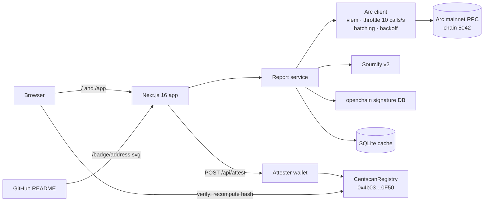
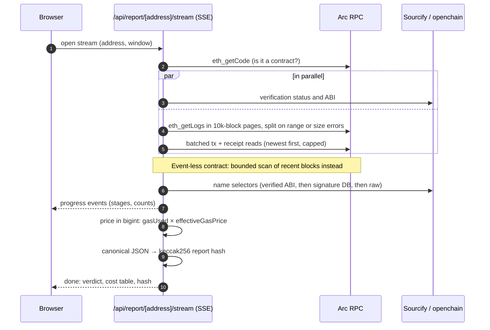
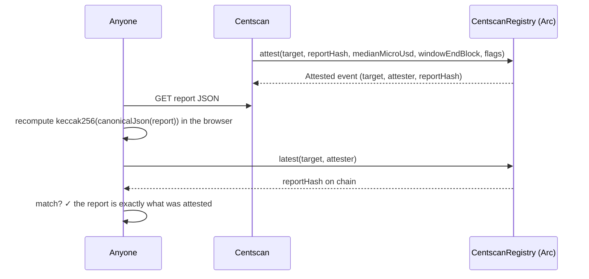
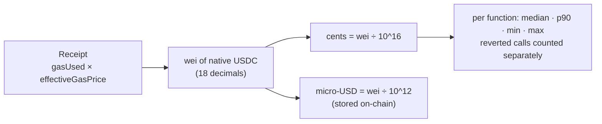

<p align="center"></p>

<p align="center">
  <a href="https://centscan.vercel.app"><b>Live site</b></a> ·
  <a href="https://centscan.vercel.app/app"><b>Scanner</b></a> ·
  <a href="https://sourcify.dev/#/lookup/0x4b0376Ec9712A7341F5903aeCC725B2a94f30F50"><b>Verified registry contract</b></a> ·
  <a href="docs/WHITEPAPER.md"><b>Whitepaper</b></a>
</p>

> **On Arc, gas is a price.** Centscan reads real transaction receipts and tells you what every function of an Arc contract costs to call, in cents. You also see whether its source is verified and whether anyone actually uses it. Every report is hashed so anyone can check it, and can be attested on Arc mainnet.

---

## The problem

Arc pays gas in **USDC**. Every transaction fee on Arc is already a dollar amount. On other chains a fee is a quantity of a volatile token, so any "this costs X" figure drifts. On Arc a price list stays true. Yet nobody shows that price.

- **Builders** can't see what each function of their contract costs their users, or which one is expensive.
- **Reviewers and grant committees** check "is this real and live on Arc mainnet?" by hand, one explorer tab at a time.
- **Finance and payments teams** need budgets ("1,000 calls ≈ $1.11"), not gas units.

### Why it's hard on Arc today

We measured each of these on Arc mainnet:

| | |
|---|---|
| `trace_*`, `debug_*` | Not supported (`-32601`), so "all calls to contract X" can't be traced |
| Explorer API | Behind a Cloudflare challenge, so it can't be used from a server |
| Public RPC | About **10 calls/s** sustained, with `-32005` rate limiting at 12–30/s |

## What Centscan does

Paste any Arc contract. In about 30 s you get:

1. **Is the source verified?** Checked against Sourcify (exact or partial match). If Sourcify is unreachable the result is "unknown", never "fail".
2. **Is it live?** Direct calls, unique senders, success rate, first and last seen block, and honest coverage notes.
3. **What does each function cost?** Median, p90, min and max in cents per function. Every row links to a sample transaction.
4. **Can I trust it?** The report is hashed as canonical JSON with keccak256. Anyone can recompute the hash in their browser and compare it with the attestation stored in `CentscanRegistry` on Arc.
5. **Can I show it?** An embeddable README badge: `centscan | verified · live · 0.111¢/call`.

## What it uses Arc for

- **USDC-denominated gas** is the product. `gasUsed × effectiveGasPrice` from real Arc receipts is already a dollar amount.
- **Arc mainnet data:** event logs and batched block reads, kept under the public RPC's budget.
- **On-chain attestations:** reports are attested to `CentscanRegistry` on Arc mainnet, so verdicts and costs are publicly verifiable.
- **Live chain telemetry:** the newest block, the base fee and the live price of a plain transfer drive the app's readouts.

## Deployed on Arc mainnet

| | |
|---|---|
| Contract | `CentscanRegistry` at [`0x4b0376Ec9712A7341F5903aeCC725B2a94f30F50`](https://explorer.arc.io/address/0x4b0376Ec9712A7341F5903aeCC725B2a94f30F50) |
| Deploy tx | [`0x3615f792…f4a68387`](https://explorer.arc.io/tx/0x3615f792ef020f450c2e482f428b7b55d9380cf9e8d25de26f21cfe5f4a68387), block 26,004,839 |
| Source | Sourcify **exact match** (creation and runtime) |
| Design | Append-only, keyed by `(target, attester)`. No owner, no upgrade path, holds no funds. `StaleWindow` blocks replaying an older report over a newer one. |

Details are in [contracts/DEPLOYMENTS.md](contracts/DEPLOYMENTS.md).

### Live attestations on Arc mainnet

| Contract | Median call | Flags | Attestation tx | Block |
|---|---|---|---|---|
| Arc USDC (`0x3600…0000`) | 0.111¢ | live | [`0x3033ac9e…d269b4f8`](https://explorer.arc.io/tx/0x3033ac9eb9c951954a1a0f545e1b350ac7314257eabfa8407bc3c9aad269b4f8) | 26,008,120 |
| Multicall3 (`0xca11…ca11`) | 1.49¢ | live | [`0x5160bb7f…a741c37d`](https://explorer.arc.io/tx/0x5160bb7f206e896a330ac4b6acbd4b47ba9389195d685252682e12fca741c37d) | 26,008,125 |
| Permit2 (`0x0000…8ba3`) | 0.0956¢ | verified + live | [`0x332cb90b…afc62e43`](https://explorer.arc.io/tx/0x332cb90b8bc14382e22291074f87a5ae5d071981a7089deb77483f41afc62e43) | 26,008,129 |

Attester: `0xF05155A3D778101E55fEfA3c516A5789E81A28CB`. Each on-chain `reportHash` was read back with `latest(target, attester)` and matches the hash recomputed from the report JSON. The three attestations cost $0.0043 in total.


## Architecture



### How a report is built



### How a report is attested and verified



### How cost is measured



A real Arc receipt: 183,288 gas × 24.000001249 gwei = **0.440¢**. A plain 21,000-gas transfer at the 20 gwei base fee = **0.042¢**.

## Honest limits

- Calls routed through other contracts (routers, multicall) are **counted, not priced**. Arc has no trace API, so pricing them would charge the router's whole transaction to this contract.
- On the public RPC, reports **sample the newest 150 transactions**, and the report says so. With a provider RPC you can raise `MAX_TXS_PER_REPORT`.
- Event-less contracts are found by a bounded scan of recent blocks. The coverage note states how many.

## Tech

- **App:** Next.js 16, React 19, TypeScript 5.9, viem 2.57, zod 4, SQLite (better-sqlite3), pino.
- **UI:** a three.js "cost observatory" hero, GSAP, and Framer Motion.
- **Contract:** Solidity 0.8.30, built and tested with Arc Foundry (`arc-forge`).
- **Quality:**
  - 321 unit and integration tests (Vitest), with collector tests replaying recorded Arc mainnet RPC responses;
  - Playwright end-to-end tests at desktop and 360 px;
  - contract tests including a fuzz test;
  - lint, typecheck and build in CI.

## Run locally

Requires Node 24 and pnpm 9. No configuration is needed: the public Arc endpoints are the defaults.

```bash
pnpm install
pnpm dev                                                    # site on :3000, scanner at /app
```

To enable attestations, set `REGISTRY_ADDRESS`, `ATTESTER_ADDRESS` and `ATTESTER_PRIVATE_KEY` in `.env.local` (see [.env.example](.env.example)).

## Checks

```bash
pnpm lint && pnpm typecheck && pnpm test:coverage && pnpm build
pnpm test:e2e
cd contracts && arc-forge test
```

## Documents

| Doc | What it covers |
|---|---|
| [Vision](docs/VISION.md) | The insight, users, principles, roadmap |
| [PRD](docs/PRD.md) | Requirements, UX states, acceptance criteria, risks |
| [Whitepaper](docs/WHITEPAPER.md) | Measurement method, attestation protocol, threat model, limits |
| [Architecture](docs/ARCHITECTURE.md) | Measured network facts, components, data model, contract, API |
| [Deploy](docs/DEPLOY.md) | Hosting, every env var, smoke checks |
| [Contracts](contracts/README.md) | `CentscanRegistry`: build, test, deploy, verify |
| [Brand](brand/BRAND.md) | Logo, colour, type, motion, voice |

## Vision

Centscan makes Arc's dollar-priced gas visible: paste any contract and see, in cents and verified on-chain, what every function really costs to use.

---

Built on Arc for the Arc Microgrants program. Centscan is an independent tool, not an Arc or Circle product. MIT licensed.
