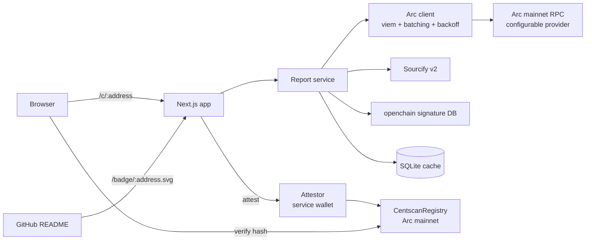

# Centscan architecture

All network facts below were measured against `https://rpc.mainnet.arc.io` on 13 Oct 2026 unless marked *unverified*.

## 1. Measured ground truth
| Fact | Value | How measured |
|---|---|---|
| Chain ID | `0x13b2` = 5042 | `eth_chainId` |
| Client | `arc/v1` | `web3_clientVersion` |
| Block time | ~0.51 s (1,000 blocks in 507 s) | timestamps of blocks 25,731,344 and 25,732,344 |
| Base fee | 20 gwei (the documented floor) | `baseFeePerGas` |
| Native USDC decimals | 18 (fees are in wei of USDC) | Arc docs; receipt maths matches |
| `eth_getLogs` max range | 10,000 blocks with an `address` filter (9,976 USDC logs returned on 14 Oct 2026); busier or unfiltered ranges can return `-32012 requested range too large` | direct calls |
| Public RPC rate limit | 10 calls/s sustained for 60 s with 0 errors; 12–30 calls/s returned `-32005 rate limit exceeded` within seconds. Each call inside a batch counts | load probe, 14 Oct 2026 |
| JSON-RPC batch | 100 requests in one POST, 0.73 s, 0 errors | batched `eth_getBlockByNumber` |
| `eth_getBlockReceipts` | Supported | |
| `trace_*`, `debug_*`, `ots_*` | **Not supported** (`-32601`) | |
| Sourcify | Arc mainnet 5042 `supported: true` | `sourcify.dev/server/chains` |
| Explorer API | Behind a Cloudflare challenge; not usable from a server | `explorer.arc.io/api/v2/*` returns "Just a moment…" |
| Example cost | 183,288 gas × 24.000001249 gwei = 0.440¢ | a live mainnet receipt |

Design consequences: there is no trace API and no explorer API, so Centscan builds its call list from **logs plus batched block reads**, and treats Sourcify as the only source of verification truth.

## 2. System overview



One deployable unit: a Next.js server with route handlers, a SQLite file on a persistent volume, and one Solidity contract.

## 3. Components

| Module | Path | Responsibility |
|---|---|---|
| Config | `src/server/config.ts` | Parse env with zod at startup; fail fast when values are missing |
| Logger | `src/server/log.ts` | pino JSON logger; request id on every line |
| Arc client | `src/server/arc/client.ts`, `src/server/arc/throttle.ts` | viem public client for viem's built-in `arc` chain; batches of 25; timeout 10 s; 5 retries from 1 s doubling; a token bucket that meters JSON-RPC calls (not HTTP requests) at `RPC_MAX_CALLS_PER_SECOND` |
| Call collector | `src/server/report/collect.ts` | Finds direct calls to the target in the window (§4) |
| Pricer | `src/server/report/price.ts` | Pure functions: cost per tx, grouping by selector, median/p90/min/max |
| Namer | `src/server/report/names.ts` | Selector to name: Sourcify ABI, then openchain, then raw |
| Sourcify client | `src/server/sourcify.ts` | Verification status and ABI |
| Report builder | `src/server/report/build.ts` | Orchestrates the steps, emits progress events, returns a `Report` |
| Canonical hash | `src/lib/canonical.ts` | Stable JSON serialisation and keccak256; shared with the browser |
| Report schema | `src/lib/report.ts` | zod schema and types for report v1, shared by server and browser |
| API contract | `src/lib/api.ts` | Response envelope, error codes, SSE event types |
| Service | `src/server/service.ts` | Wires store, builder and rate limits for the routes; maps errors to HTTP status |
| Store | `src/server/store.ts` | SQLite: reports, rate limits, attestations |
| Attestor | `src/server/attest.ts` | Signs and sends `attest()` from the service wallet; waits for the receipt |
| Badge | `src/server/badge.ts` | Builds a shields-style SVG from a report |
| Contract | `contracts/src/CentscanRegistry.sol` | On-chain attestations |

## 4. Collecting calls (the hard part)

Goal: every transaction in `[fromBlock, toBlock]` whose `to` equals the target.

**Path A: contracts that emit events (most contracts)**
1. `eth_getLogs({ address: target })` in 10,000-block pages, newest first, 2 pages at a time; a 24 h window is ~18 pages. A `-32012` range error, or the public RPC's "query exceeds max results 2000", halves the page, down to 100 blocks.
2. De-duplicate the `transactionHash` values, newest first, and stop at `MAX_TXS_PER_REPORT` (default 150).
3. Fetch `eth_getTransactionByHash` and `eth_getTransactionReceipt` for 50 hashes at a time (viem splits them into batches of 25).
4. Keep only transactions where `tx.to == target`. Logs emitted during calls routed through another contract count as **indirect** usage and are reported as a count only. Pricing them would charge the router's whole transaction to this contract.

**Path B: event-less contracts, or when Path A finds nothing**
1. Batch `eth_getBlockByNumber(n, true)` over the last `SCAN_FALLBACK_BLOCKS` blocks (default 300 ≈ 2.5 min of chain time, ~30 s at the public RPC's 10 calls/s; use 10,000 with a provider RPC), 50 at a time.
2. Filter transactions by `to == target`, then batch-fetch their receipts.
3. Set coverage to `{ kind: "block-scan", blocks: 300 }` so the UI says so.

**Contract creation:** if the deploy transaction is in the window, it is found by Path B only. Otherwise it is omitted, and the report says "deploy cost not in window".

**Progress:** each page emits `{ step, done, total }`. The page streams these over Server-Sent Events from `/api/report/:address/stream`.

## 5. Pricing maths
```
costWei   = receipt.gasUsed * receipt.effectiveGasPrice    // bigint, wei of native USDC
cents     = costWei / 10^16                                 // display with 3 significant decimals
microUsd  = costWei / 10^12                                 // integer, stored on-chain
selector  = tx.input.slice(0, 10) or "receive()" when input == "0x"
```
All maths uses `bigint` until display. Medians and p90 come from the sorted bigint array (nearest-rank method). Reverted transactions (`status == 0`) are grouped separately.

## 6. Data model

### Report JSON (`schemaVersion: 1`)
```ts
type Verdict = "pass" | "warn" | "fail" | "unknown";
interface Report {
  schemaVersion: 1;
  chainId: 5042;
  target: `0x${string}`;            // lowercase
  window: { fromBlock: string; toBlock: string; hours: 1 | 24 | 168; blockTimeMs: number };
  generatedAt: string;              // ISO 8601 UTC
  source: { verdict: Verdict; match: "exact_match" | "match" | null; sourcifyUrl: string };
  activity: {
    verdict: Verdict; directCalls: number; successfulCalls: number; indirectTxs: number; uniqueSenders: number;
    firstSeenBlock: string | null; lastSeenBlock: string | null;
    coverage: { kind: "logs" } | { kind: "block-scan"; blocks: number };
    sampled: { analysed: number; found: number; scannedFromBlock: string } | null;
  };
  functions: Array<{
    selector: `0x${string}` | "receive()" | "deploy";
    name: string | null; nameSource: "abi" | "signature-db" | null;
    calls: number; medianGas: string;
    costMicroUsd: { median: string; p90: string; min: string; max: string };
    sampleTx: `0x${string}`;
  }>;
  reverted: { calls: number; totalMicroUsd: string };
  headline: { medianMicroUsd: string | null; per1000Usd: string | null };
}
```
Bigints are serialised as decimal strings. The authoritative definition is the zod schema in `src/lib/report.ts`; every report is parsed against it before it is stored or attested. `blockTimeMs` is measured per report over the last 10,000 blocks, so the window in hours maps onto the chain's real pace.

### Canonical hash
`reportHash = keccak256(utf8(canonicalJson(report)))`, where `canonicalJson` sorts object keys recursively, adds no whitespace and keeps array order. The page shows the JSON and a "Recompute hash" button that runs the same function in the browser (shared module).

### SQLite tables
```sql
CREATE TABLE reports (
  target TEXT NOT NULL, window_hours INTEGER NOT NULL, to_block INTEGER NOT NULL,
  report_json TEXT NOT NULL, report_hash TEXT NOT NULL, created_at TEXT NOT NULL,
  PRIMARY KEY (target, window_hours, to_block)
);
CREATE INDEX reports_latest ON reports (target, window_hours, created_at DESC);
CREATE TABLE attestations (
  report_hash TEXT PRIMARY KEY, target TEXT NOT NULL, tx_hash TEXT NOT NULL UNIQUE,
  attester TEXT NOT NULL, block_number INTEGER NOT NULL, created_at TEXT NOT NULL
);
CREATE INDEX attestations_target ON attestations (target, block_number DESC);
CREATE TABLE rate_limits (key TEXT PRIMARY KEY, window_start INTEGER NOT NULL, count INTEGER NOT NULL);
```
Migrations are numbered SQL files with paired `down` files, applied at boot inside a transaction.

## 7. Smart contract: `CentscanRegistry`
```solidity
// SPDX-License-Identifier: MIT
pragma solidity 0.8.30;

/// Append-only attestations of Centscan reports. No owner, no upgrade, no funds held.
contract CentscanRegistry {
    struct Attestation {
        bytes32 reportHash;
        uint64  medianCostMicroUsd;
        uint64  windowEndBlock;
        uint32  timestamp;
        uint8   flags;          // bit0 = source verified, bit1 = live
    }

    mapping(address target => mapping(address attester => Attestation)) public latest;

    event Attested(
        address indexed target, address indexed attester, bytes32 indexed reportHash,
        uint64 medianCostMicroUsd, uint64 windowEndBlock, uint8 flags
    );

    uint8 public constant FLAG_SOURCE_VERIFIED = 1;
    uint8 public constant FLAG_LIVE = 2;

    error ZeroTarget();
    error ZeroReportHash();
    error StaleWindow(uint64 previous, uint64 given);

    function attest(address target, bytes32 reportHash, uint64 medianCostMicroUsd, uint64 windowEndBlock, uint8 flags) external {
        if (target == address(0)) revert ZeroTarget();
        if (reportHash == bytes32(0)) revert ZeroReportHash();
        Attestation storage prev = latest[target][msg.sender];
        if (windowEndBlock <= prev.windowEndBlock) revert StaleWindow(prev.windowEndBlock, windowEndBlock);
        latest[target][msg.sender] = Attestation(reportHash, medianCostMicroUsd, windowEndBlock, uint32(block.timestamp), flags);
        emit Attested(target, msg.sender, reportHash, medianCostMicroUsd, windowEndBlock, flags);
    }
}
```
- Keying by `(target, attester)` means anyone can attest without overwriting the official attester. The UI trusts only the configured `ATTESTER_ADDRESS` and labels everything else as third-party.
- `StaleWindow` stops replaying an older report over a newer one. `ZeroReportHash` keeps the empty slot value (all zeros) meaning "never attested".
- The source of truth is [contracts/src/CentscanRegistry.sol](../contracts/src/CentscanRegistry.sol); `tests/registry-abi.test.ts` keeps the app's ABI in sync with the compiled contract.
- The contract is built and deployed with **Arc Foundry** (`arc-forge`), as Arc's docs require, and verified on **Sourcify** (`--verifier sourcify`). The Blockscout API path is avoided because of the open bug circlefin/arc-node#210, which so far is reported on testnet only.

## 8. HTTP surface
| Route | Method | Purpose | Limits |
|---|---|---|---|
| `/` | GET | Landing page | |
| `/c/[address]` | GET | Report page (server-rendered from cache, streams a refresh if none) | |
| `/api/report/[address]?hours=24` | GET | Latest cached report JSON (404 if none) | |
| `/api/report/[address]/stream?hours=24` | GET (SSE) | Build a fresh report with progress | 1 per address per 5 min, 20 per IP per hour, 240 per hour service-wide, at most 3 builds in flight |
| `/api/attest/[address]` | POST | Attest the latest report from the service wallet | 1 per address per 10 min, 6 per IP per hour, 30 per hour service-wide; requires a report less than 1 h old |
| `/badge/[address].svg` | GET | README badge | `Cache-Control: public, max-age=3600` |

Responses use the envelope `{ ok: true, data } | { ok: false, error: { code, message, retryAfterSeconds? } }`, typed in `src/lib/api.ts`. Addresses are validated with viem `isAddress` and then lowercased. The client IP for rate limits is the **last** `X-Forwarded-For` hop (the one the hosting proxy appends; the first hop is client-controlled), validated with `net.isIP`.

| Error code | HTTP | When |
|---|---|---|
| `INVALID_ADDRESS`, `INVALID_WINDOW` | 400 | Bad path or `hours` |
| `NOT_A_CONTRACT`, `NOT_FOUND` | 404 | No code at the address; no cached report |
| `RATE_LIMITED` | 429 | Refresh or attest limit hit; `Retry-After` header set |
| `REPORT_TOO_OLD`, `STALE_WINDOW` | 409 | Attesting a report over 1 h old; a newer window is already on-chain |
| `RPC_UNAVAILABLE`, `ATTEST_DISABLED`, `ATTESTER_UNFUNDED` | 503 | Upstream or wallet problems |
| `INTERNAL` | 500 | Unexpected; logged with request id |

The stream route always answers `200 text/event-stream`, because `EventSource` cannot read an error body: a refusal or failure arrives as an `error` event carrying the same `ApiError`. Events: `progress` (`{ step, done, total }`), `done` (`ReportPayload`), `error` (`ApiError`). A failed build releases that contract's 5-minute refresh lock so the user can retry at once; the per-IP budget still counts.

## 9. Configuration (env, validated at boot)
| Var | Example | Required |
|---|---|---|
| `ARC_RPC_URL` | `https://rpc.mainnet.arc.io` | yes |
| `ARC_CHAIN_ID` | `5042` | yes (boot asserts it equals `eth_chainId`) |
| `REGISTRY_ADDRESS` | deployed address | yes |
| `ATTESTER_PRIVATE_KEY` | secret | yes for the attest route; the app still serves reports without it, and the attest button explains why it is disabled |
| `ATTESTER_ADDRESS` | public address | yes |
| `DATABASE_PATH` | `/data/centscan.db` | yes |
| `SOURCIFY_URL` | `https://sourcify.dev/server` | yes |
| `SIGNATURE_DB_URL` | `https://api.openchain.xyz/signature-database/v1` | yes |
| `SCAN_FALLBACK_BLOCKS` | `10000` | no (default) |
| `MAX_TXS_PER_REPORT` | `150` | no (default; ~30 s on the public RPC) |
| `RPC_MAX_CALLS_PER_SECOND` | `10` | no (default, measured safe on the public RPC) |
| `RPC_BURST` | `25` | no (default) |
| `LOG_LEVEL` | `info` | no |

## 10. Stack (versions from npm on 13 Oct 2026)
next 16.4, react 19.3, viem 2.57, zod 4.6, better-sqlite3 13.0, pino 10.4, framer-motion 14.1, vitest 5.0, @playwright/test 1.64.
TypeScript is pinned to 5.x: npm's latest is 7.0 (the new native compiler), and Next.js 16 compatibility with it is *unverified*, so it is not worth the risk under the deadline.
Contracts: Arc Foundry (`arc-forge`, `arc-cast`) with Solidity 0.8.30.

## 11. Failure handling
| Failure | Behaviour |
|---|---|
| RPC timeout or 429 | Retry with backoff (250 ms × 2^n, jitter, 4 attempts), then fail that step with `RPC_UNAVAILABLE`; the stream shows a retry button |
| `getLogs` range error | Halve the page size and retry (floor 100 blocks) |
| Sourcify down | `source.verdict = "unknown"`; report continues |
| openchain down | Names fall back to raw selectors; report continues |
| Client disconnects mid-stream | `AbortSignal` cancels in-flight RPC batches |
| Attest tx reverts (`StaleWindow`) | 409 with "A newer report is already attested" |
| Wallet out of USDC | 503 `ATTESTER_UNFUNDED`; logged at error level; badge and reports unaffected |

## 12. Deployment
- Dockerfile (multi-stage, `node:24-slim`, non-root user) deployed to Railway or Fly with a persistent volume at `/data`.
- The registry contract is deployed once from a separate deployer key. The attester is a separate hot wallet holding about $2 of USDC, enough for at least 1,400 attestations. That figure is *estimated*: a first attestation for a target writes 2 new storage slots (about 70k gas, about 0.14¢ at 20 gwei), and later ones overwrite them (about 30k gas, about 0.06¢). Measure the real cost after deploy, using Centscan itself.
- CI on GitHub Actions: lint, typecheck, vitest, `arc-forge test`, Playwright against a production build, and a Docker build.

## 13. Testing strategy
| Layer | What | Doubles |
|---|---|---|
| Unit | `price.ts` (median/p90, bigint maths, revert grouping), `canonical.ts` (stable hash), `badge.ts`, `throttle.ts`, `http.ts`, `store.ts`, `service.ts`, address validation | clock and fetch only |
| Integration | `collect.ts` against recorded RPC fixtures from real mainnet responses (Path A, Path B, range-error halving) | HTTP transport only |
| Contract | `arc-forge test`: attest, zero target, stale window, attester isolation, event fields | none |
| E2E | Playwright: paste address → streamed report → receipt rows → badge snippet; plus 360 px viewport | live mainnet RPC (nightly), fixtures in CI |
